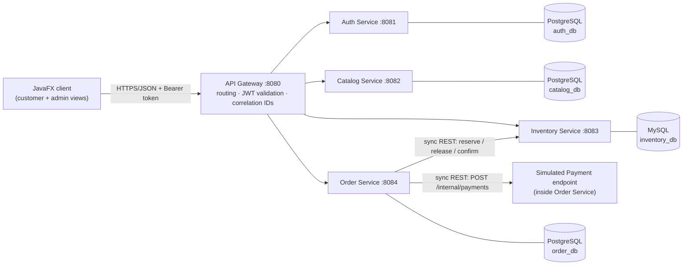
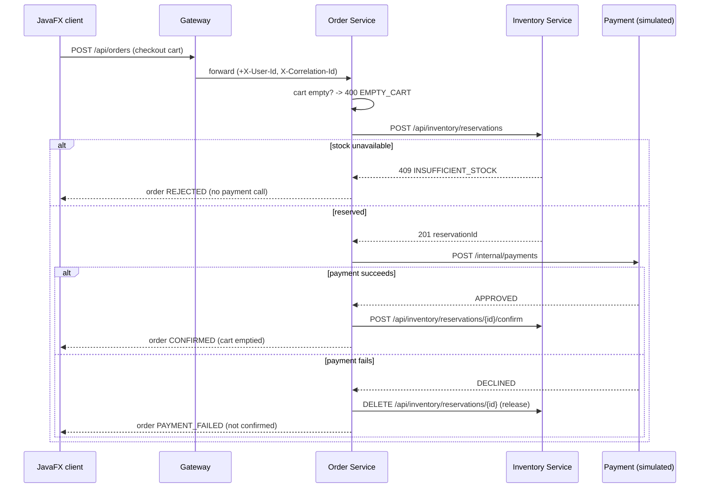

# Architecture

> The professor's requirements are in the root [`README.md`](../README.md). This document explains
> how the repository implements them. Planning and progress: [`TASKS.md`](../TASKS.md).

## Components

| Module | Responsibility (README §2) | Tech | Port | Database |
| --- | --- | --- | --- | --- |
| `api-gateway` | Routing, token validation, correlation IDs | Spring Cloud Gateway (WebFlux) | 8080 | — |
| `auth-service` | Registration, login, PBKDF2 hashing, token issuing | Spring Boot MVC, JPA, spring-security-crypto, JJWT | 8081 | PostgreSQL |
| `catalog-service` | Books, authors, categories, search | Spring Boot MVC, JPA | 8082 | PostgreSQL |
| `inventory-service` | Stock levels, stock reservations | Spring Boot MVC, JPA | 8083 | MySQL |
| `order-service` | Carts, orders, calls to Inventory and simulated Payment | Spring Boot MVC, JPA, `RestClient` | 8084 | PostgreSQL |
| `bookstore-client` | JavaFX shopping + admin client | JavaFX 21, `java.net.http`, Jackson | — | — |
| `bookstore-common` | Header names, error format, correlation-id filter | plain Java (+ provided spring-web) | — | — |
| `e2e-tests` | End-to-end scenario against the composed stack | JUnit 5, `java.net.http` | — | — |

**Database per service:** each service owns its schema (Flyway migrations in
`src/main/resources/db/migration`) and no service reads another service's database.
Cross-service references (e.g. `book_id` in Inventory/Order, `user_id` in Order) are plain ids.

## Communication rules

1. The client only talks to the **API Gateway** (`BOOKSTORE_GATEWAY_URL`, default `http://localhost:8080`).
2. The gateway validates the JWT (secret shared with Auth), then forwards `X-User-Id` and
   `X-User-Role`. `/api/admin/**` requires role `ADMIN`. Public paths: `/api/auth/**` and catalogue/stock `GET`s.
3. The gateway creates an `X-Correlation-Id` (or keeps the client's), forwards it; every service puts it
   in the logging MDC and forwards it on outgoing calls (Order → Inventory/Payment).
4. Services trust the `X-User-*` headers because they are only reachable inside the Docker network
   (only the gateway port is published in `docker-compose.yml`).
5. Inter-service calls are **synchronous REST** with timeouts; a failure of a downstream service is
   mapped to a clear error (`503 SERVICE_UNAVAILABLE`) that the client can display.
6. Every error body follows `com.bookstore.common.error.ErrorResponse`.

## Order processing (README §3.3)

Order statuses: `PENDING` → `CONFIRMED` | `REJECTED` (out of stock) | `PAYMENT_FAILED`.

## Testing strategy (README §4)

| Level | Where | Tooling | Maven phase |
| --- | --- | --- | --- |
| Unit (TDD order rules: empty cart, out of stock, refused payment) | `*/src/test/java/**/service/*Test` | JUnit 5, Mockito, AssertJ | `test` (Surefire) |
| Web layer | `*/src/test/java/**/controller/*Test` | `@WebMvcTest` | `test` |
| Repository | `*/src/test/java/**/repository/*IT` | Testcontainers (PostgreSQL / MySQL) | `verify` (Failsafe) |
| Contract Order → Inventory | `contracts/inventory-api` + `order-service/.../contract`, `inventory-service/.../contract` | WireMock stubs, verified against the real Inventory Service | `verify` |
| End-to-end | `e2e-tests` | JUnit 5 + HTTP against the gateway of `docker compose up --wait` | `verify -Pe2e` |

## CI/CD (README §5)

| Workflow | Trigger | What it does |
| --- | --- | --- |
| `.github/workflows/ci.yml` | `on: push` | path filters → `service-ci.yml` for each changed module → `docker compose up --wait` → e2e tests against the gateway |
| `.github/workflows/service-ci.yml` | called by CI | `./mvnw -pl <module> -am verify` (unit + integration tests) |
| `.github/workflows/deploy.yml` | CI succeeded on `main` | push images to GHCR (`sha-<commit>`, `latest`), SSH to the demo machine, `scripts/deploy.sh` (pull, up, `/health` checks, rollback to previous tag) |
| `.github/workflows/release.yml` | tag `v*` | versioned images on GHCR, jpackage installers (Linux/Windows/macOS), GitHub Release with installers + `docker-compose.yml` |

## Key decisions and assumptions

| Decision | Reason |
| --- | --- |
| Java 21 (LTS), Spring Boot 4.0, Spring Cloud 2025.1, JavaFX 21 (LTS) | Current supported versions that work together; JavaFX 21 runs on JDK 21. |
| Maven multi-module repository (one parent POM) | One build for both students; each service still builds, tests and ships independently (`-pl <module> -am`, one Docker image per service). |
| JWT (HMAC-SHA256) as the "token" | Stateless: the gateway can validate tokens without calling Auth on every request. |
| PBKDF2 via `Pbkdf2PasswordEncoder` (spring-security-crypto only) | Required by the README, without pulling in the full Spring Security filter chain. |
| Simulated Payment endpoint inside the Order Service (`/internal/payments`), URL configurable | README lists exactly five services; a configurable URL lets tests stub it with WireMock. |
| Deterministic payment rule (proposal: amount > 500.00 **or** card/token `"DECLINE"` → declined) | Makes "refused payment" reproducible in unit, contract and manual tests. To be confirmed in TASK-02. |
| Reservation decrements available stock immediately; release restores it; confirm makes it final | The E2E test can check that stock decreased right after purchase. |
| Book covers stored as URLs (`books.cover_url`), loaded asynchronously by the client | Keeps binary data out of the database; a placeholder image is shown on failure. |
| Business DTOs are **not** shared between services | Each service owns its API; the Order → Inventory contract is guarded by contract tests. |
